<picture>
  <source media="(max-width: 700px)" srcset="assets/hero-m.svg" />
  
</picture>

<a href="https://snifexcodes.github.io/snifexcodes/">
  <picture>
    <source media="(max-width: 700px)" srcset="assets/enter-3d-m.svg" />
    
  </picture>
</a>

<picture>
  <source media="(max-width: 700px)" srcset="assets/title-stack-m.svg" />
  
</picture>

<picture>
  <source media="(max-width: 700px)" srcset="assets/skills-m.svg" />
  
</picture>

<picture>
  <source media="(max-width: 700px)" srcset="assets/title-projects-m.svg" />
  
</picture>

<a href="https://github.com/snifexcodes/Mudra">
  <picture>
    <source media="(max-width: 700px)" srcset="assets/featured-m.svg" />
    
  </picture>
</a>

<a href="https://github.com/snifexcodes?tab=repositories">
  <picture>
    <source media="(max-width: 700px)" srcset="assets/projects-m.svg" />
    
  </picture>
</a>

<picture>
  <source media="(max-width: 700px)" srcset="assets/title-activity-m.svg" />
  
</picture>

 

<b>✦ more about me</b>

 

🎓 BCA student at Tilak Maharashtra Vidyapeeth 
🛠️ I build full-stack web apps and automation tools 
🐧 I experiment with Linux, VMs and boot setups

